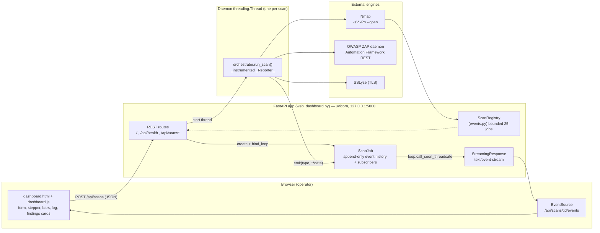
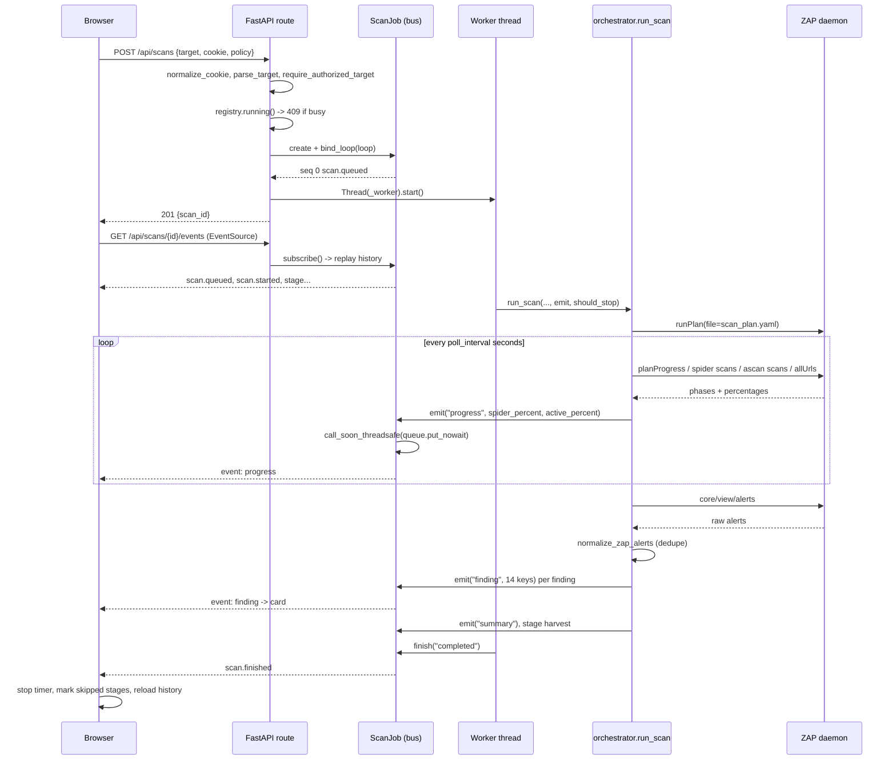

# CyberSentinel Findings Dashboard — Complete Technical Documentation (Module 2)

> **Purpose of this document.** This is the deep-dive reference for the CyberSentinel web dashboard, written for
> oral-examination (viva) preparation. It covers *what* was built, *how* every part works down to the function and
> line level, *why* each technology decision was made, *what evidence* proves it runs, and *which questions* an
> examiner is likely to ask. Every `file:line` reference below has been verified against the code in this repository.
> Line numbers refer to the state of the files at the time of writing.

---

## Table of contents

1. [Problem statement and objectives](#1-problem-statement-and-objectives)
2. [What Module 2 adds on top of Module 1](#2-what-module-2-adds-on-top-of-module-1)
3. [High-level architecture](#3-high-level-architecture)
4. [Technology stack and justification](#4-technology-stack-and-justification)
5. [File map](#5-file-map)
6. [The four-stage pipeline](#6-the-four-stage-pipeline)
7. [The event catalogue — 13 event types](#7-the-event-catalogue--13-event-types)
8. [Complete request lifecycle (end-to-end trace)](#8-complete-request-lifecycle-end-to-end-trace)
9. [The central engineering problem: thread → asyncio boundary](#9-the-central-engineering-problem-thread--asyncio-boundary)
10. [Server-Sent Events protocol specification](#10-server-sent-events-protocol-specification)
11. [Refresh safety: append-only history and replay](#11-refresh-safety-append-only-history-and-replay)
12. [Backend walkthrough: `web_dashboard.py`](#12-backend-walkthrough-web_dashboardpy)
13. [Backend walkthrough: `events.py`](#13-backend-walkthrough-eventspy)
14. [Backend walkthrough: `orchestrator.py` instrumentation](#14-backend-walkthrough-orchestratorpy-instrumentation)
15. [Backend walkthrough: `zap_client.py` progressive polling](#15-backend-walkthrough-zap_clientpy-progressive-polling)
16. [Session cookie injection into ZAP](#16-session-cookie-injection-into-zap)
17. [Vulnerability scope: the policy dropdown](#17-vulnerability-scope-the-policy-dropdown)
18. [The findings data contract](#18-the-findings-data-contract)
19. [Severity and active-vs-passive taxonomy](#19-severity-and-active-vs-passive-taxonomy)
20. [Deduplication — the single source of truth](#20-deduplication--the-single-source-of-truth)
21. [Frontend walkthrough: HTML structure](#21-frontend-walkthrough-html-structure)
22. [Frontend walkthrough: `dashboard.js`](#22-frontend-walkthrough-dashboardjs)
23. [Frontend walkthrough: `dashboard.css`](#23-frontend-walkthrough-dashboardcss)
24. [HTTP API reference](#24-http-api-reference)
25. [Security design and guardrails](#25-security-design-and-guardrails)
26. [Verification evidence (measured runs)](#26-verification-evidence-measured-runs)
27. [Test suite](#27-test-suite)
28. [Limitations and future work](#28-limitations-and-future-work)
29. [Troubleshooting](#29-troubleshooting)
30. [Viva question bank](#30-viva-question-bank)
31. [Cheat sheet — numbers to memorize](#31-cheat-sheet--numbers-to-memorize)

---

## 1. Problem statement and objectives

### 1.1 The problem

A DAST (Dynamic Application Security Testing) engine such as OWASP ZAP produces enormous amounts of low-level
telemetry: spider runs, scan progress percentages, hundreds of raw alerts with nested fields, and engine-specific
JSON. A terminal run of an orchestration CLI answers the question *"can we drive the scanner programmatically?"*,
but it does **not** answer the question a developer or reviewer actually asks:

> **"What is broken, where exactly, how serious is it, what evidence proves it, and how do I fix it?"**

Three concrete pain points drove Module 2:

| # | Pain point in a CLI-only workflow | What the dashboard must provide |
|---|--------------------------------|---------------------------------|
| 1 | Scans take minutes; a CLI prints progress once at the end, so the operator cannot tell a hung scan from a slow one. | **Live progress** per stage, with spider and active-scan percentages streaming while the engine runs. |
| 2 | Authenticated scanning is awkward — ZAP must carry the operator's session, and pasting a raw `Cookie:` header into a CLI flag is error-prone. | **Paste-the-cookie UX** that accepts both forms and injects the session into the engine reliably. |
| 3 | Raw ZAP alerts are unreadable: nested JSON, inconsistent field names, no triage affordances. | **An understandable findings dashboard** — the stated highest priority. |

### 1.2 Objectives, in the priority order given by the requirements

**Highest priority — an understandable findings dashboard.** Each vulnerability is shown with all of:
**name, severity, affected URL, vulnerable parameter, evidence, confidence, and recommended fix.**
That is seven required columns; the implementation renders all seven plus additional context (CWE, source engine,
scan type, attack payload, reference link). See [§18](#18-the-findings-data-contract) for the exact field mapping.

**Secondary objectives:**

1. **Live progress streaming** — no page reload, no polling, visible within one tick of the engine reporting.
2. **One code path** — the dashboard must call the *exact same* pipeline as the CLI. No duplicated scan logic.
   This is a design constraint, not a nicety: duplicated logic means the dashboard and CLI can disagree, and a
   student demo loses all credibility when the numbers differ.
3. **Refresh safety** — pressing F5 mid-scan must not lose the run or the findings.
4. **Triage affordances** — severity filters, active/passive tabs, free-text search, and severity-first sorting.
5. **Non-disclosure of the session cookie** — the cookie is a credential; it must never be echoed by an API response.
6. **Authorization guardrail** — scanning a remote host requires an explicit attestation.

### 1.3 Scope decisions made with the user

These were chosen explicitly (via a design questionnaire) before implementation, and are worth stating in a viva
because they show deliberate trade-offs rather than accidental choices:

- **Stack:** FastAPI + Uvicorn + **Server-Sent Events** (over WebSockets, over polling, over a full SPA).
- **What the dashboard scans:** the **full pipeline** — Nmap service discovery → ZAP spider + active scan →
  SSLyze TLS audit → normalized harvest. Not a ZAP-only stub.
- **Vulnerability scope in the UI:** a **dropdown** with `all`, `sqli`, `xss`, `csrf`.

---

## 2. What Module 2 adds on top of Module 1

| Concern | Module 1 (CLI prototype) | Module 2 (findings dashboard) |
|---|---|---|
| Entry point | `python orchestrator.py --target-url ...` | Browser at `http://127.0.0.1:5000` |
| Progress | `print()` lines, terminal only | SSE event stream, staged stepper + dual progress bars + log feed |
| Authenticated target | `--cookie` flag (operator had to know it existed) | Cookie textarea; accepts `security=low; PHPSESSID=…` **and** a copied `Cookie: …` header |
| Scope | `--policy` flag | Dropdown, validated server-side against `SCAN_POLICIES` |
| Findings | JSON artifact + terminal table | Interactive cards: filter, tab, search, sort, expandable detail |
| Concurrency | one foreground process | one enforced concurrent scan, HTTP `409` on collision |
| History | on-disk directories only | in-memory registry (`/api/scans`) + on-disk artifacts, linked per scan |
| Scan logic | `orchestrator.run_scan()` | **the same** `orchestrator.run_scan()` — zero duplication |

The last row is the architectural answer to "did you rewrite the scanner for the web?" — **no.** The dashboard is a
*transport and presentation* layer bolted onto Module 1's engine by way of two optional callback parameters.

---

## 3. High-level architecture



**Four layers, one responsibility each:**

1. **Engine layer** — Nmap, ZAP, SSLyze. Unchanged from Module 1. Knows nothing about HTTP.
2. **Pipeline layer** — `orchestrator.run_scan()`. Sequences the engines, normalizes findings, writes artifacts, and
   *optionally* reports progress through an injected `emit` callback.
3. **Bus layer** — `events.py`. A thread-safe publish/subscribe hub with an append-only log per scan.
4. **Transport + presentation layer** — `web_dashboard.py` (REST + SSE) and `templates/dashboard.html`,
   `static/dashboard.js`, `static/dashboard.css` (rendering and triage UX).

The important property: **the dependency arrow only points one way.** The pipeline never imports FastAPI. It only
knows it may call a callable. That is why `python orchestrator.py` still works exactly as before.

---

## 4. Technology stack and justification

### 4.1 Chosen stack

| Layer | Choice | Version constraint | Role |
|---|---|---|---|
| Web framework | **FastAPI** | `>=0.115,<1` | Routing, Pydantic request validation, dependency-free JSON |
| ASGI server | **Uvicorn** | `>=0.30,<1` | Single-process asyncio server bound to loopback |
| Progress transport | **Server-Sent Events** (hand-rolled `StreamingResponse`) | stdlib | One-way server→browser event stream |
| Templating | **Jinja2** (via FastAPI) | — | One server-rendered shell page |
| Frontend | **Vanilla JS** (IIFE, no framework, no build step) | — | SSE handling, DOM rendering, triage |
| Event bus | `threading.Lock` + `asyncio.Queue` + `loop.call_soon_threadsafe` | stdlib | Cross-thread fan-out |
| Engines | `python-nmap`, ZAP Automation Framework REST, `sslyze` | — | Actual scanning |

### 4.2 Why SSE and not WebSockets

This is the single most likely viva question about the architecture. Answer it with reasoning, not preference:

| Criterion | Polling | **SSE (chosen)** | WebSockets |
|---|---|---|---|
| Direction of traffic needed | S→C | **S→C only** | C↔S full duplex |
| Protocol | HTTP GET, trivially cache/proxy-friendly | HTTP GET, `text/event-stream` | `Upgrade:` handshake, own framing |
| Client code | `setInterval` + fetch | native `EventSource`, **automatic reconnect with `Last-Event-ID`** | manual socket, manual reconnect, manual heartbeat |
| Server code | none extra | one `StreamingResponse`, ~25 lines | WS route, connection registry, close handling |
| Reconnect semantics | implicit | **built into the browser** | must be implemented by hand |
| Text encoding | JSON body | UTF-8 by spec | must handle binary/text frames yourself |
| Cost of the wrong choice | wasted requests + latency | negligible | added complexity with **no feature bought** |

The argument in one sentence: **progress is a one-way broadcast of text; SSE gives exactly that, natively in the
browser, over plain HTTP, with reconnect for free — WebSockets would add a bidirectional protocol we never use.**

Two additional SSE-specific design points worth being able to state:

- Named events (`event: finding`) let the client register a listener per type rather than branch on a payload field.
  The client subscribes to all 13 names — see `EVENT_NAMES` in [static/dashboard.js:12-16](file:///C:/Users/BTECH7/Desktop/SEM_7/PRJ_7%20-%20Copy/CyberSentinel/static/dashboard.js#L12-L16).
- `id:` frames carry the monotonic `seq`, so the browser can resume with `Last-Event-ID` after a dropped
  connection. The server-side replay in `subscribe()` covers the case where the *page* itself reloaded.

### 4.3 Why not a polling SPA / why no React

- A React/Vue SPA would require a build toolchain, a dev server, and a bundler for what is one page and one stream.
  A zero-build vanilla IIFE loads instantly, has no dependencies to audit, and is easier to explain line by line.
- Polling `GET /api/scans/{id}` every second would deliver the same data, but at the cost of latency (up to one
  interval), request overhead (each poll serializes the whole job), and no way to show sub-second engine progress.
  The event history would still be needed for replay, so polling does not remove the append-only log — it only adds
  waste on top of it.
- An off-the-shelf platform (DefectDojo, Arachni UI, ZAP Desktop itself) would answer the presentation question but
  would not demonstrate orchestration, which is the actual learning objective of this project.

### 4.4 Why a thread and not `asyncio.to_thread` / not an async pipeline

The engines are **blocking, synchronous, third-party code**: `python-nmap` runs a subprocess and waits; the ZAP
poller is a `while` loop of `urllib` GETs with `time.sleep()`. Making the pipeline `async` would mean rewriting
`discovery.py`, `zap_client.py`, and `tls_audit.py` with `aiohttp`/`asyncio.subprocess` and then auditing that
rewrite. Running the unchanged synchronous function in one `threading.Thread` and bridging events into the loop with
`call_soon_threadsafe` is ~10 lines, keeps GIL-bounded I/O off the event loop, and reuses Module 1 verbatim. The
cost is the explicit bridge, which [§9](#9-the-central-engineering-problem-thread--asyncio-boundary) documents.

---

## 5. File map

| File | Lines | Status | Responsibility |
|---|---|---|---|
| `web_dashboard.py` | 232 | new | FastAPI app: routes, request model, cookie normalization, worker launch, SSE encoder |
| `events.py` | 179 | new | `ScanJob` (append-only event log + subscribers + thread bridge) and `ScanRegistry` (bounded history) |
| `static/dashboard.js` | 515 | new | SSE wiring, stage/bar/log rendering, findings store, filter/search/sort, card builder |
| `static/dashboard.css` | 319 | new | Dark "console" theme, severity palette, stepper, bars, log, history, findings grid, responsive breakpoint |
| `templates/dashboard.html` | 145 | new | Page shell: scan form, live-progress card, recent-scans list, findings card |
| `orchestrator.py` | 403 | modified | Added `_Reporter` (:32), module-level `finding_to_dict` (:55), `emit`/`should_stop` params on `run_scan` (:85) |
| `zap_client.py` | 466 | modified | Added `version()` (:109), `spider_results()` (:117), progress-aware `poll_plan` (:141) with `flush_spider_urls` (:164) and cancellation |
| `normalizer.py` | 218 | modified | `normalize_zap_alerts` (:46) now deduplicates exact repeats — the single source of truth for finding counts |
| `tests/test_dashboard.py` | 83 | new | 7 regression tests for cookie handling, contract completeness, replay, redaction, eviction |
| **Total (dashboard-relevant)** | **~2560** | | |

Supporting files carried over from Module 1 and *not* rewritten: `discovery.py`, `targeting.py`, `models.py`,
`exceptions.py`, `tls_audit.py`, `storage.py`, `cli.py`.

Run command (note the loopback bind):

```bash
python -m uvicorn web_dashboard:app --host 127.0.0.1 --port 5000
```

---

## 6. The four-stage pipeline

`run_scan()` executes four named stages. Each emits `stage` events with status `started` → `completed` (or `failed`),
which the UI renders as a stepper. The stage names are the contract between backend and frontend; they are declared
independently in both places and must match.

| # | Stage key | UI label | Backend code | Events emitted |
|---|---|---|---|---|
| 1 | `discovery` | Nmap service discovery | [orchestrator.py:117-144](file:///C:/Users/BTECH7/Desktop/SEM_7/PRJ_7%20-%20Copy/CyberSentinel/orchestrator.py#L117-L144) | `stage` ×2, `services` |
| 2 | `zap` | ZAP spider + active scan | [orchestrator.py:150-206](file:///C:/Users/BTECH7/Desktop/SEM_7/PRJ_7%20-%20Copy/CyberSentinel/orchestrator.py#L150-L206) | `stage`, `plan`, `progress`, `urls`, `finding`, `error` |
| 3 | `tls` | SSLyze TLS audit | [orchestrator.py:213-224](file:///C:/Users/BTECH7/Desktop/SEM_7/PRJ_7%20-%20Copy/CyberSentinel/orchestrator.py#L213-L224) | `stage`, `finding`, `error` |
| 4 | `harvest` | Harvest & triage findings | [orchestrator.py:230-273](file:///C:/Users/BTECH7/Desktop/SEM_7/PRJ_7%20-%20Copy/CyberSentinel/orchestrator.py#L230-L273) | `stage`, `summary` |

Declared on the frontend at [static/dashboard.js:5-10](file:///C:/Users/BTECH7/Desktop/SEM_7/PRJ_7%20-%20Copy/CyberSentinel/static/dashboard.js#L5-L10):

```js
const STAGES = [
  { key: "discovery", label: "Nmap service discovery" },
  { key: "zap",       label: "ZAP spider + active scan" },
  { key: "tls",       label: "SSLyze TLS audit" },
  { key: "harvest",   label: "Harvest & triage findings" },
];
```

Two behaviours of interest:

- **Stage 2 loops over web services.** Nmap may find several HTTP ports; each gets its own generated plan, its own
  `plan` event, and its own `zap` stage run. Plan files are disambiguated by `_plan_path()`
  ([orchestrator.py:76-82](file:///C:/Users/BTECH7/Desktop/SEM_7/PRJ_7%20-%20Copy/CyberSentinel/orchestrator.py#L76-L82))
  so a second service cannot overwrite the first.
- **Skipped stages are still shown.** If Nmap finds no web service, ZAP/SSLyze never run; when `scan.finished`
  arrives the frontend marks any stage it never heard about as `skipped`, or `failed` if the job failed
  ([static/dashboard.js:316-318](file:///C:/Users/BTECH7/Desktop/SEM_7/PRJ_7%20-%20Copy/CyberSentinel/static/dashboard.js#L316-L318)).
  An honest UI shows what did *not* happen.

---

## 7. The event catalogue — 13 event types

Every event is a dict `{"seq": int, "ts": float, "type": str, "data": {...}}`. The `data` payload is whatever the
`emit()` keyword arguments were. This table is the authoritative protocol spec.

| Type | Emitted by | Payload keys | UI effect |
|---|---|---|---|
| `scan.queued` | `web_dashboard.start_scan` (:170) | full public request | status badge → "queued" (deliberately **no** log line) |
| `scan.started` | `ScanJob.mark_running` (events.py:90) | full public request | status → running, meta fields, start elapsed timer, one log line |
| `stage` | `orchestrator._Reporter.stage` (:46) | `stage`, `status`, `message` | advances the stepper dot + tooltip |
| `progress` | `orchestrator` (:164) ← `ZAPClient.poll_plan` (:141) | `engine`, `target`, `plan_id`, `elapsed`, `job`, `spider_percent`, `active_percent`, `finished` | drives both bars, elapsed clock, and the ZAP stage label |
| `urls` | `orchestrator` (:167) ← `on_urls` | `engine`, `target`, `urls[]` | "URLs discovered" list + count |
| `services` | `orchestrator` (:123) | `services[]` of `{host,port,protocol,state,service_name,product,version,is_web,supports_tls}` | discovered-services list |
| `plan` | `orchestrator` (:157) | `target`, `plan_path`, `policy` | log line naming the generated Automation Framework plan |
| `finding` | `orchestrator` (:192, :217) | all 14 contract keys, see [§18](#18-the-findings-data-contract) | appended to the findings store → card render |
| `log` | `_Reporter.log/print` (:38-44) | `message` | one line in the scrolling log feed |
| `error` | `orchestrator` (:206, :224), `_worker` (:90, :95) | `message`, optional `stage` | red log line |
| `summary` | `orchestrator` (:273) | `target`, `status`, `findings[]` | "Harvested N finding(s) — status X" log line |
| `scan.cancelling` | `web_dashboard.stop_scan` (:197) | `message` | log line; teardown continues |
| `scan.finished` | `ScanJob.finish` (events.py:97) | `status`, `result`, `error` | stops timer, sets badge, marks unreported stages, reloads history, **closes the stream** |

Frontend list of subscribed names — [static/dashboard.js:12-16](file:///C:/Users/BTECH7/Desktop/SEM_7/PRJ_7%20-%20Copy/CyberSentinel/static/dashboard.js#L12-L16):

```js
const EVENT_NAMES = [
  "scan.queued", "scan.started", "scan.finished", "scan.cancelling",
  "stage", "progress", "urls", "services", "plan", "finding",
  "summary", "log", "error",
];
```

`scan.finished` is the only event that terminates the generator; see [web_dashboard.py:219-220](file:///C:/Users/BTECH7/Desktop/SEM_7/PRJ_7%20-%20Copy/CyberSentinel/web_dashboard.py#L219-L220).

---

## 8. Complete request lifecycle (end-to-end trace)

Nine steps, from keypress to rendered card, with the exact code location for each.

**1. Operator submits the form.**
`#scan-form` has `onsubmit` → `submitScan(event)` which calls `event.preventDefault()`, reads the seven fields, and
issues `POST /api/scans` with a JSON body. While awaiting, the button is disabled and the label changes so a double
click cannot queue two scans.

**2. Pydantic validates the body.**
`ScanRequest` ([web_dashboard.py:40-48](file:///C:/Users/BTECH7/Desktop/SEM_7/PRJ_7%20-%20Copy/CyberSentinel/web_dashboard.py#L40-L48))
enforces `target_url` length 8–2048, `cookie` ≤ 4096, `policy` ≤ 40, `zap_url` ≤ 512 (defaulting from
`CYBERSENTINEL_ZAP_URL`), `zap_timeout` between 30 and 3600 (default 360), and `authorized: bool = False`.
A violation is a `422` before any of our code runs.

**3. Cookie normalized, then policy/target/authorization checked.**
`normalize_cookie()` (:51) then `parse_target()` and `require_authorized_target()` (:147-148) from Module 1's
`targeting.py`. A `CyberSentinelError` becomes `HTTP 400` with the human message as `detail`
([web_dashboard.py:149-150](file:///C:/Users/BTECH7/Desktop/SEM_7/PRJ_7%20-%20Copy/CyberSentinel/web_dashboard.py#L149-L150)).
Order matters: validation happens **before** any process is spawned, so a bad request costs zero scanner time.

**4. Single-scan enforcement.**
`registry.running()` (:152) returns any job in `running`, else any in `queued`. If found → `HTTP 409` naming the
offending scan id and target. Rationale: one ZAP daemon, one target, and a shared `scan_results/` tree; concurrent
scans would corrupt the demo more than they would help it.

**5. Job creation + loop binding + first event.**
`registry.create({...})` builds a `ScanJob` with a 12-hex-char id. `job.bind_loop(asyncio.get_running_loop())` (:169)
captures the *server's* loop — this is the precondition for the thread bridge. `job.emit("scan.queued",
**job.public_request())` (:170) appends event `seq 0`. The cookie is present in `job.request` but excluded by
`public_request()`; only `cookie_provided: true` is published.

**6. Worker thread starts; HTTP response returns immediately.**
`threading.Thread(target=_worker, args=(job,), daemon=True).start()` (:171-172) and the route returns
`201 {"scan_id", "status"}` (:173). The request/response cycle is finished in milliseconds while a multi-minute scan
is still beginning — which is precisely why a separate streaming channel is needed.

**7. Pipeline runs and reports.**
`_worker` (:64) flips the job to `running` (emitting `scan.started`), sets `output_directory =
RESULTS_DIR/job.id`, and calls `run_scan(...)` with `emit` and `should_stop` injected, and
`policy=None if policy == "all" else policy`. Inside, the `_Reporter` mirrors every `print()` to the terminal **and**
to `emit`, so the CLI and the dashboard get the same words from the same call sites. `ZAPClient.poll_plan` then
drives `progress`/`urls` per poll, and each normalized alert becomes a `finding` event.

**8. Event crosses the thread boundary and reaches the HTTP response.**
`ScanJob.emit` appends under `self._lock`, snapshots the subscriber set, then calls `_deliver` per subscriber, which
runs `loop.call_soon_threadsafe(queue.put_nowait, event)` (events.py:76). The `asyncio.Queue` belongs to the
`scan_events` generator, which is awaiting `queue.get()` with a 15-second timeout. It yields `_sse(event)`, and
Starlette flushes one SSE frame to the browser.

**9. Browser renders.**
`EventSource` dispatches by event name → `handleEvent(event)` (:264) switches on `event.type`. A `finding` calls
`addFinding(data)` → pushes to `state.findings` → `scheduleFindingsRender()` batches repaints on
`requestAnimationFrame` so a burst of 20 alerts repaints the list once, not twenty times. Severity chips and the
count badge update from the same store, so filters always reflect the live set.

Termination: `run_scan` returns a `ScanSummary`; `_worker` maps it to `completed`, `completed_with_errors` (findings
exist but a stage errored), or `cancelled` if `job.cancel_requested`. `job.finish(...)` emits `scan.finished`, which
closes the generator in step 8's route and makes the frontend stop the timer and refresh history.



---

## 9. The central engineering problem: thread → asyncio boundary

**The problem, stated precisely.** Uvicorn serves the SSE response from an asyncio event loop. The scan runs in a
`threading.Thread` because the engine code is blocking and synchronous. You **cannot** call
`asyncio.Queue.put_nowait()` from another thread and expect the awaiting coroutine to wake up: asyncio objects are
explicitly not thread-safe, and the loop only notices changes when it is running inside itself. A naive
`queue.put_nowait()` from the worker either deadlocks the stream until some other event wakes the loop, or corrupts
loop-internal state.

**The fix — `call_soon_threadsafe`.** It is the one asyncio API designed for this: it schedules a callback *on* the
loop from any thread, using a self-pipe/IOCP wakeup so a loop blocked in `select()` is interrupted immediately.

[events.py:70-78](file:///C:/Users/BTECH7/Desktop/SEM_7/PRJ_7%20-%20Copy/CyberSentinel/events.py#L70-L78):

```python
def _deliver(self, queue: asyncio.Queue, event: dict[str, Any]) -> None:
    loop = self._loop
    if loop is None or loop.is_closed():
        queue.put_nowait(event)
        return
    try:
        loop.call_soon_threadsafe(queue.put_nowait, event)
    except RuntimeError:
        pass
```

Three details that are worth defending:

1. **`bind_loop` must be called from the async route.** `start_scan` is `async def`
   ([web_dashboard.py:142](file:///C:/Users/BTECH7/Desktop/SEM_7/PRJ_7%20-%20Copy/CyberSentinel/web_dashboard.py#L142))
   solely so that `asyncio.get_running_loop()` (:169) can capture the loop while the request is being handled.
   (This was a real bug found during implementation: the route was written `def`, `get_running_loop()` had no
   running loop to return, and it had to be converted to `async def`.)
2. **The `loop is None` fallback is not dead code.** `_worker` emits `scan.started` from its own thread; but if a job
   is ever driven without a bound loop, or during interpreter teardown after the loop closed, delivering directly is
   correct degradation rather than a crash. `RuntimeError` is swallowed for the same reason: the loop can be closed
   between the `is_closed()` check and the call.
3. **`emit` never blocks and never raises into the pipeline.** `emit` appends under a lock and returns; the worker
   thread additionally wraps the call in a `try/except Exception: pass`
   ([web_dashboard.py:71-75](file:///C:/Users/BTECH7/Desktop/SEM_7/PRJ_7%20-%20Copy/CyberSentinel/web_dashboard.py#L71-L75)).
   **A dashboard hiccup must never abort a security scan.** Losing a 6-minute ZAP run because a browser tab was
   closed would be a worse failure than losing the live view.

The symmetric half of the bridge is the consumer: `queue.get()` is awaited *inside the loop*, with a 15-second
timeout used to emit a keep-alive comment
([web_dashboard.py:214-217](file:///C:/Users/BTECH7/Desktop/SEM_7/PRJ_7%20-%20Copy/CyberSentinel/web_dashboard.py#L214-L217)).

---

## 10. Server-Sent Events protocol specification

### 10.1 Frame encoder

[web_dashboard.py:231-232](file:///C:/Users/BTECH7/Desktop/SEM_7/PRJ_7%20-%20Copy/CyberSentinel/web_dashboard.py#L231-L232):

```python
def _sse(event: dict[str, Any]) -> str:
    return f"id: {event['seq']}\nevent: {event['type']}\ndata: {json.dumps(event)}\n\n"
```

- `id:` — the monotonic sequence number. Enables `Last-Event-ID` resumption.
- `event:` — the *event name*; drives `EventSource.addEventListener(name, …)` dispatch. Without it every message
  would arrive as a generic `message` and the client would have to branch on a payload field.
- `data:` — the complete JSON envelope (including `type`, so a frame is self-describing and debuggable with `curl`).
- A **blank line terminates the frame**. Getting this wrong is the classic SSE bug — the browser waits forever.

### 10.2 Verbatim wire capture

Captured against a live scan of DVWA's CSRF page with the ZAP API on port 8085 (first three frames):

```
id: 0
event: scan.queued
data: {"seq": 0, "ts": 1793095071.8531263, "type": "scan.queued", "data": {"target_url": "http://127.0.0.1:4280/vulnerabilities/csrf/?password_new=ss&password_conf=ss&Change=Change", "policy": "csrf", "zap_url": "http://127.0.0.1:8085", "zap_timeout": 300, "authorized": false, "cookie_provided": true}}

id: 1
event: scan.started
data: {"seq": 1, ...,"type": "scan.started", "data": { ...same public request... }}

id: 2
event: stage
data: {"seq": 2, ...,"type": "stage", "data": {"stage": "discovery", "status": "started", "message": "Discovering services on http://127.0.0.1:4280/vulnerabilities/csrf/"}}
```

Note what is **absent** from frame 0 even though the operator pasted a cookie: there is no `PHPSESSID` value, only
`"cookie_provided": true`. This is `public_request()` doing its job.

### 10.3 Response headers

[web_dashboard.py:224-228](file:///C:/Users/BTECH7/Desktop/SEM_7/PRJ_7%20-%20Copy/CyberSentinel/web_dashboard.py#L224-L228):

| Header | Value | Why |
|---|---|---|
| `Content-Type` | `text/event-stream` | required by the SSE spec; otherwise `EventSource` refuses the stream |
| `Cache-Control` | `no-cache` | a proxy or the browser must not serve a stale stream |
| `X-Accel-Buffering` | `no` | disables nginx buffering; without it all frames arrive in one lump at the end |
| `Connection` | `keep-alive` | the response must remain open for minutes |

### 10.4 Keep-alive and lifetime

Idle for 15 s yields a comment frame `": keep-alive\n\n"`. Comments are ignored by `EventSource` but keep bytes
moving, which prevents intermediaries and OS buffers from concluding the connection is dead. `finally:
job.unsubscribe(queue)` guarantees the subscriber set does not grow when a tab closes
([web_dashboard.py:221-222](file:///C:/Users/BTECH7/Desktop/SEM_7/PRJ_7%20-%20Copy/CyberSentinel/web_dashboard.py#L221-L222)).

### 10.5 Curl reproduction (useful in a viva demo)

```bash
curl -N http://127.0.0.1:5000/api/scans/<scan_id>/events
```

`-N` disables curl's own buffering. The proof that SSE, not polling, is carrying the data is visible here: one
request, then frames appearing over minutes.

---

## 11. Refresh safety: append-only history and replay

**Requirement:** pressing F5 mid-scan must neither lose the run nor leave a blank panel.

**Mechanism:** each `ScanJob` keeps `self.events` as an **append-only log**, and `subscribe()` replays it into the new
subscriber's queue *before* registering it
([events.py:43-51](file:///C:/Users/BTECH7/Desktop/SEM_7/PRJ_7%20-%20Copy/CyberSentinel/events.py#L43-L51)):

```python
def subscribe(self) -> asyncio.Queue:
    queue: asyncio.Queue = asyncio.Queue()
    with self._lock:
        for event in self.events:
            queue.put_nowait(event)
        self._subscribers.add(queue)
    return queue
```

Both operations happen under the same lock, so **no event can be lost between replay and registration** — if the
replay and the registration were not atomic, an event emitted in that window would be missed forever.

**Ordering guarantee:** `seq` is assigned inside the lock as `len(self.events)` immediately before the append
([events.py:61-63](file:///C:/Users/BTECH7/Desktop/SEM_7/PRJ_7%20-%20Copy/CyberSentinel/events.py#L61-L63)), so
sequence numbers are dense and monotonic per job even though `emit` is called from the worker thread.

**Re-attachment:** on load, the page calls `/api/health`; if `active_scan` is non-null the frontend calls
`connect(thatId)` ([static/dashboard.js:418-435](file:///C:/Users/BTECH7/Desktop/SEM_7/PRJ_7%20-%20Copy/CyberSentinel/static/dashboard.js#L418-L435)).
So a reload silently rejoins the running scan and the replayed history refills the stepper, bars, log, and every
finding card. Completed scans are reachable from the Recent-scans list, which reads
`GET /api/scans/{id}` with `include_events=True` and re-hydrates findings from the stored `finding` events rather
than re-parsing the log.

**This design also makes the SSE channel stateless from the browser's point of view** — the server, not the socket,
owns the truth. That is the same reasoning behind event sourcing, applied to a scan feed.

---

## 12. Backend walkthrough: `web_dashboard.py`

232 lines, 6 module constants, 1 request model, 3 helpers, 7 routes.

### 12.1 Module setup

| Line | Symbol | Note |
|---|---|---|
| 29-30 | `BASE_DIR`, `RESULTS_DIR` | artifacts land in `scan_results/<scan_id>/` — one directory per scan, matching the CLI's layout |
| 31 | `POLICY_CHOICES` | `{"all"} ∪ SCAN_POLICIES.keys()` — derived, not hand-copied, so a new policy in `zap_client.py` is automatically valid here |
| 32 | `DEFAULT_ZAP_URL` | `CYBERSENTINEL_ZAP_URL` env override, else `http://127.0.0.1:8080` (ZAP's default API port). Needed because the daemon port is an environment fact, not an application constant |
| 34-37 | `app`, `/static` mount, `templates`, `registry` | `registry = ScanRegistry()` is the only mutable global state in the app |

### 12.2 `ScanRequest` (:40)

Field-level validation, all of it meaningful:

- `target_url: str = Field(..., min_length=8, max_length=2048)` — the lower bound is a cheap "this is not a typo"
  check (`http://` alone is 7); the upper bound prevents a pathological body from reaching `urlsplit` and the regex
  scope builder.
- `cookie: str | None = Field(default=None, max_length=4096)` — optional (unauthenticated scans are legitimate);
  4 KB is far above any real cookie jar and inside most header limits.
- `policy: str = Field(default="all", max_length=40)` — membership is checked against `POLICY_CHOICES` in the route,
  not by an enum, so the error message can list the valid choices.
- `zap_url`, `zap_timeout` (`ge=30, le=3600`) — the bounds protect against a timeout of 0 (instant failure) or
  effectively infinite (a wedged job holding the single-scan slot).
- `authorized: bool = False` — **the default is the safe value.** The operator must actively check the box.

### 12.3 `normalize_cookie()` (:51)

```python
cleaned = " ".join(value.strip().splitlines()).strip()
if cleaned.lower().startswith("cookie:"):
    cleaned = cleaned[len("cookie:") :].strip()
if any(ord(character) < 32 or ord(character) == 127 for character in cleaned):
    raise HTTPException(status_code=422, detail="Cookie must not contain control characters.")
```

Three defences, each traceable to a real failure mode:

1. **Multi-line joining.** DevTools "Copy value" and Burp/Proxy header copies routinely bring trailing newlines; a
   raw `\n` inside a header value breaks the ZAP plan's YAML or, worse, splits into an extra header.
2. **`Cookie:` prefix stripping.** The example the requirement was written with was literally
   `Cookie: security=low; PHPSESSID=7c4e24…`. A user who pastes exactly that must not get a doubled header.
3. **Control-character rejection (CRLF guard).** This is header/CRLF-injection hygiene: the value is destined for an
   HTTP request the engine will send. Reject rather than sanitize, because a silent strip would change which session
   the operator believes they are testing.

### 12.4 `_worker()` (:64) — the thread body

```python
summary = run_scan(
    job.request["target_url"],
    zap_base_url=job.request["zap_url"],
    authorized=job.request["authorized"],      # <- was hardcoded True; that bypassed the guardrail
    output_directory=output_directory,
    zap_timeout=job.request["zap_timeout"],
    cookie=job.request.get("cookie"),
    policy=None if policy == "all" else policy, # "all" -> let ZAP use its default policy
    emit=emit,
    should_stop=lambda: job.cancel_requested,   # cooperative cancellation
)
```

Four points to be able to explain:

- **`authorized` must be threaded through.** It is validated again inside `run_scan`, but hardcoding `True` in the
  worker would have made the whole guardrail decorative for every dashboard scan. This was caught during
  implementation and is a good "how did you verify your own safety check" anecdote.
- **`policy="all"` maps to `None`,** which makes `write_zap_plan` omit the `activeScan-policy` jobs entirely and let
  ZAP run its default full rule set — an *absence* of configuration, not a made-up policy name.
- **Two-tier exception handling.** `CyberSentinelError` (the project's own base) → `failed` with the domain message;
  any other `Exception` → `failed` with `"Unexpected dashboard failure: …"`. The second tier exists because a worker
  thread that dies silently leaves a job stuck in `running` forever, which in turn blocks every future scan via the
  409 check. Every exit path must call `finish()`.
- **Outcome mapping:** `cancelled` (operator pressed Stop) is distinguished from `completed_with_errors` (a stage
  failed but findings were still harvested) from `completed`. Those strings are what the badge shows.

### 12.5 `_result()` (:107)

The compact summary persisted on the job: `target`, `status`, `services`, `active_count`, `passive_count`,
`total_count`, `errors[]`. Splitting active/passive counts here is deliberate — the dashboard's headline number is
"confirmed exploits vs informational warnings", and storing both makes the history list honest without re-reading
`findings.json`.

### 12.6 Routes

| Method | Path | Line | Behaviour worth stating |
|---|---|---|---|
| GET | `/` | 119 | Jinja shell. Server-rendered so the page paints before JS runs |
| GET | `/api/health` | 124 | **Preflight.** Probes the ZAP daemon with a 3 s timeout, reports `nmap.available`, the id of any `active_scan`, and the allowed `policies`. Exists so "ZAP isn't running" surfaces on page load instead of 4 minutes into a failed scan |
| POST | `/api/scans` | 141 | `async def` (needs the loop), 201 on success, 400 validation, 409 busy |
| GET | `/api/scans` | 176 | History for the Recent-scans panel (newest first, from `reversed(self._order)`) |
| GET | `/api/scans/{id}` | 181 | Full detail with `include_events=True` → `findings[]` + `events[]`. Used when clicking a past scan |
| POST | `/api/scans/{id}/stop` | 189 | Sets the cancel flag, emits `scan.cancelling`, returns `cancelling`; `409` if already finished |
| GET | `/api/scans/{id}/events` | 201 | The SSE stream |

`/api/health` accepts `?zap_url=` so the UI can re-probe after the operator edits the ZAP API field — this is the
answer to "your machine's ZAP is on 8082/8085, not 8080".

---

## 13. Backend walkthrough: `events.py`

179 lines. Two classes. This file is the reason the dashboard needs no database and no message broker.

### 13.1 `ScanJob` state (:22-35)

| Attribute | Type | Purpose |
|---|---|---|
| `id` | 12-hex `uuid4` prefix | short, URL-safe, collision-resistant; doubles as the artifact directory name |
| `request` | dict | the *private* request, including the real cookie |
| `events` | list | append-only log — the replay source |
| `findings` | list | derived index of every `finding` payload, for counts and detail views |
| `status` | `queued` → `running` → terminal | drives the badge and the 409 check |
| `result`, `error`, `started_at`, `finished_at` | | summary + elapsed time |
| `_cancel` | `threading.Event` | cooperative cancellation flag |
| `_lock` | `threading.Lock` | guards `events`, `findings`, `_subscribers` |
| `_loop` | bound asyncio loop | for the thread bridge |
| `_subscribers` | `set[asyncio.Queue]` | one queue per open HTTP stream |

### 13.2 `emit()` (:57) — why the subscriber set is snapshotted

```python
with self._lock:
    event["seq"] = len(self.events)
    self.events.append(event)
    if event_type == FINDING_EVENT:
        self.findings.append(data)
    subscribers = tuple(self._subscribers)
for queue in subscribers:
    self._deliver(queue, event)
```

The lock is taken only for the mutation, and the actual delivery happens **outside** it. Two reasons: (a)
`call_soon_threadsafe` schedules onto another thread's loop; holding the job lock across that is a lock-ordering
liability; (b) if a subscriber's delivery raised or blocked, no other publisher or subscriber could make progress.
Snapshotting to a tuple means a concurrent `subscribe()`/`unsubscribe()` cannot mutate the collection mid-iteration
(the classic "dictionary changed size during iteration" crash).

### 13.3 Lifecycle helpers (:81-97)

`request_cancel()` sets the `threading.Event`; `cancel_requested` is a property read by the pipeline's `should_stop`
lambda. `mark_running()` both flips the status and emits `scan.started`. `finish()` records the terminal status and
emits `scan.finished`. Because `finish` emits, the terminal event is in the history too — so a page loaded *after*
the scan ended still receives the correct final state on replay. That is the reason a completed scan can be viewed
live-consistent.

### 13.4 `public_request()` (:100) — the redaction boundary

```python
public = {key: value for key, value in self.request.items() if key != "cookie"}
public["cookie_provided"] = bool(self.request.get("cookie"))
```

Every serialisation path (`to_dict`, and both `scan.queued` and `scan.started` payloads) goes through this. Redaction
is therefore **structural, not per-call-site**: there is no route to forget it. A test enforces it —
`test_cookie_never_leaves_the_public_payload`
([tests/test_dashboard.py](file:///C:/Users/BTECH7/Desktop/SEM_7/PRJ_7%20-%20Copy/CyberSentinel/tests/test_dashboard.py)).

### 13.5 `severity_counts()` (:107) and `to_dict()` (:114)

Counts are computed from the live `findings` list, never cached, so the chips in the UI and the JSON agree while the
scan is mid-flight. `to_dict(include_events=False)` is the list/history shape; `True` adds `findings` and `events`
for the detail view. Keeping events out of the list response matters: 25 jobs × hundreds of progress frames would
make `/api/scans` enormous.

### 13.6 `ScanRegistry` (:132) — bounded, and eviction-aware

```python
def _find_evictable(self) -> str | None:
    """Only drop finished jobs so an operator never loses an in-flight scan."""
```

`max_history=25`. `create()` trims only while over budget and only via `_find_evictable()`, which skips `queued` and
`running`. So history is a ring buffer over *finished* scans. `running()` (:171) checks `running` before `queued` —
a subtlety found by a test, not by reading: preferring the newest job would have returned a just-created queued scan
and reported a genuine in-flight scan as "already running" with the wrong id.

---

## 14. Backend walkthrough: `orchestrator.py` instrumentation

The change that makes "one code path" true. Three additions, no behavioural change for the CLI.

### 14.1 `_Reporter` (:32)

```python
class _Reporter:
    def __init__(self, emit: Callable[..., None] | None = None) -> None:
        self._emit = emit

    def print(self, message): print(message); self.log(message)   # terminal + "log" event
    def log(self, message):   self._emit("log", message=message)  # event only
    def stage(self, stage, status, message=""): self._emit("stage", ...)
    def send(self, event_type, **data):        self._emit(event_type, **data)
```

Why a class and not bare calls: **it collapses the `if emit is not None` guard into one place** at all 20+ reporting
sites, and it separates two genuinely different intents — `print` is a human log line that *also* becomes an event,
while `log` is an event with no terminal echo (used by the dashboard path where printing again would duplicate).

This fixed a real duplication bug: early on, `scan.queued` and `scan.started` both wrote a log line, and a `stage`
event wrote a message that the `[+]` log line had already printed, so the browser feed showed the same sentence
twice. The fix: `stage` events drive **only** the stepper, `log` events drive **only** the feed, and `scan.queued`
sets **only** the status badge ([static/dashboard.js:267-279](file:///C:/Users/BTECH7/Desktop/SEM_7/PRJ_7%20-%20Copy/CyberSentinel/static/dashboard.js#L267-L279)).

### 14.2 `finding_to_dict()` (:55) — promoted to module level

Previously a nested closure inside `run_scan`. It referenced `RawFinding` and `Any`, neither of which was imported;
it survived only because `from __future__ import annotations` defers annotation evaluation — a latent crash the
moment anything tried to resolve the annotations. Fixing this meant: add the real imports, move the function to
module scope so `web_dashboard` and the tests can call it, and delete the function-local `Counter` import.
**Its keys are the contract** in [§18](#18-the-findings-data-contract), and a test asserts the seven required columns
are present.

### 14.3 `run_scan()` signature (:85)

Two new optional keyword parameters, both defaulting to `None`:

- `emit: Callable[..., None] | None` — when absent, `_Reporter` is a no-op and the function is exactly Module 1's
  CLI pipeline. When present, every stage, percentage, URL batch, and finding is published.
- `should_stop: Callable[[], bool] | None` — polled before each ZAP poll.

This is the **Dependency Inversion** that keeps the presentation layer out of the engine layer: `orchestrator` does
not know what a queue, an HTTP response, or a browser is. It knows only "someone may be listening".

### 14.4 Event sites

| Line | Event | Payload |
|---|---|---|
| 117, 140 | `stage discovery` | started / completed with the service counts |
| 123 | `services` | per-port dicts incl. `is_web`, `supports_tls` (so the UI can show *why* a port was routed) |
| 155 | `stage zap started` | |
| 157 | `plan` | generated YAML path + effective policy |
| 164 | `progress` | the poll telemetry, `engine="zap"` |
| 167 | `urls` | spider-discovered URLs |
| 192 | `finding` ×N | full contract, active + passive |
| 193 | `stage zap completed` | raw alert count |
| 205-206 | `stage zap failed` + `error` | per-service ZAP failure; the loop continues with other services |
| 213, 217, 218, 223-224 | `tls` stage, TLS `finding`s, TLS error | |
| 230, 250, 253 | `harvest` stage | started / completed with the artifact count / failed if the write fails |
| 273 | `summary` | `target`, `status`, all findings serialized |

Note the deliberate **redundancy at the end**: every finding was already streamed individually as a `finding` event,
and `summary` then carries the whole list. The streamed events make the UI live; `summary` makes the final state
authoritative and lets a late subscriber reconstruct everything from one event.

---

## 15. Backend walkthrough: `zap_client.py` progressive polling

`poll_plan` (:141) grew three keyword arguments: `on_progress`, `on_urls`, `should_stop`.

Per poll cycle it now:

1. checks `should_stop()` **before** issuing requests → if the operator pressed Stop, it calls `stop_plan(plan_id)`
   and raises `ScanExecutionError(f"ZAP plan {plan_id} was cancelled by the operator.")`. Graceful: it tells the
   engine to stop rather than abandoning an orphaned plan that would keep hammering the target.
2. reads `automation/status` for the plan, `spider/view/scans` and `ascan/view/scans` for phase counts.
3. computes `spider_percent` and `active_percent`, and emits via `on_progress`:

```python
on_progress({"plan_id": plan_id, "elapsed": elapsed, "job": current_job,
             "spider_percent": spider_percent, "active_percent": active_percent,
             "finished": bool(finished)})
```

4. calls the nested `flush_spider_urls()` (:164), which pulls `spider/view/allUrls` and pushes them through
   `on_urls` — but only when the set actually grew, so the browser is not re-sent the same list every 5 seconds.

**Why two flush points:** `flush_spider_urls()` is invoked both when the spider finishes *before* the active scan
starts (so the operator sees the crawl surface, which is often the interesting part) **and** when the plan finishes
(so nothing discovered late by the forced-off spider pass is missed).

`version()` (:109) exists purely for `/api/health`; `spider_results()` (:117) for `flush_spider_urls`;
`scan_counts()` (:104) for the phase totals. All three swallow their own errors and return `None`/`[]` —
**a health probe must never raise a 500 because the daemon is down.**

---

## 16. Session cookie injection into ZAP

### 16.1 The problem

DVWA (and any real authenticated app) returns "not logged in" for every request that lacks `PHPSESSID`. ZAP's spider
and active scan make their own requests; if the session is not injected, the scanner crawls the login page and
reports an empty scan — a **false negative**, which in security tooling is the dangerous kind of wrong.

### 16.2 The two-mechanism solution

`write_zap_plan()` ([zap_client.py:283](file:///C:/Users/BTECH7/Desktop/SEM_7/PRJ_7%20-%20Copy/CyberSentinel/zap_client.py#L283))
emits both:

1. **`requestHeaders` job** — a global `Cookie:` header added to every request ZAP sends. The natural first attempt.
2. **`replacer` job** — an extendable-rule override with `matchType: "req_header"` that *substitutes* the Cookie
   header. This is the belt-and-braces mechanism: ZAP Desktop's own session tokens and the spider's internally
   generated requests can bypass `requestHeaders`, and the replacer operates at the raw-HTTP level, so it wins.

Plus **`sessionManagement: method: "cookie"`** so ZAP understands the cookie is the session credential and preserves
session state across the spider's requests.

The commit that added the replacer exists precisely because `requestHeaders` alone proved insufficient — a good
"how do you know?" answer to give an examiner.

### 16.3 Real generated plan (abridged, from `scan_results/8f25c2e76305/scan_plan.yaml`)

```yaml
---
version: 5
env:
  contexts:
  - name: "Module1-Prototype"
    urls: "http://127.0.0.1:4280/vulnerabilities/sqli/?id=dd&Submit=Submit"
    includePaths:
    - "^http://127\\.0\\.0\\.1:4280/vulnerabilities/sqli(?:[/?].*)?$"
    excludePaths:
    - "^http://127\\.0\\.0\\.1:4280/(logout\\.php|login\\.php|security\\.php|dvwa/includes/dvwaPage\\.ini|).*$"
    ...
    sessionManagement:
      method: "cookie"
      fullURIList: []
components:
  requestHeaders:
    header: |
      Cookie: security=low; PHPSESSID=7c4e24996d1d5e554acdd7a21c9108da
jobs:
- name: "Inject Session Cookie"
  type: "replacer"
  enabled: true
  matchString: "Cookie"
  replacementString: "security=low; PHPSESSID=7c4e24996d1d5e554acdd7a21c9108da"
  matchType: "req_header"
- type: "activeScan-policy"
  name: "CyberSentinel-sqli"
  policyName: "CyberSentinel-sqli"
  defaultThreshold: "off"
  defaultStrength: "medium"
  rules: [ {"id": "40018"}, {"id": "40019"}, {"id": "40020"}, ... ]
- type: "spider"
  ...
- type: "passiveScan-wait"
- type: "activeScan"
  maxScanDuration: 5
```

### 16.4 Scope and logout protection

- **`includePaths`** is generated by `zap_scope_regex()` (`targeting.py`): the target URL **without its query**,
  regex-escaped, anchored with `^…(?:[/?].*)?$`. Trailing-slash handling is deliberate — a pasted
  `/vulnerabilities/sqli/?id=1` must scope to `/vulnerabilities/sqli`, and naive prefix regexes either fail to match
  `/vulnerabilities/sqli/` or over-match a sibling like `/vulnerabilities/sqlimap`. Escaping is also a
  **security** property: an unescaped `.` in `127.0.0.1` would match `127x0x1`, and a target containing regex
  metacharacters could otherwise widen the scope beyond the authorized host.
- **`excludePaths`** anchors the DVWA logout/login/security pages to `scheme + authority` only. Scanning logout would
  destroy the operator's session mid-scan (turning the rest of the run into an unauthenticated crawl) — so it is
  excluded rather than merely avoided.

---

## 17. Vulnerability scope: the policy dropdown

`SCAN_POLICIES` ([zap_client.py:49](file:///C:/Users/BTECH7/Desktop/SEM_7/PRJ_7%20-%20Copy/CyberSentinel/zap_client.py#L49))
maps a friendly name to a list of ZAP **active-scan rule IDs**:

| Dropdown value | ZAP rule IDs | Families |
|---|---|---|
| `sqli` | 40018, 40019, 40020, 40021, 40022, 40024 | SQL injection (MySQL/ORacle/PostgreSQL/BDB, generic blind, time-based) |
| `xss` | 40012, 40014, 40016, 40017, 40026 | Reflected/DOM-stored/persistent XSS, CSP bypass, custom banner |
| `csrf` | 20012 | Anti-CSRF Token |
| `all` | *(no policy jobs)* | ZAP's default full rule set |

How it becomes a scan:

1. The dashboard sends `policy` in the JSON body; it is validated against `POLICY_CHOICES`.
2. `_worker` passes `policy=None if policy == "all" else policy` into `run_scan`.
3. `write_zap_plan` emits `activeScan-policy` job blocks with `defaultThreshold: "off"` and only the listed rules.
   `"off"` means *no other rule family runs* — the essential narrowing for a scoped demo scan; without it ZAP keeps
   its whole rule base and the "scope" selection is decorative.
4. `ZAPClient.alerts()` (:233) **post-filters** by the same rule ids
   (`allowed_plugin_ids = {str(r["id"]) for r in SCAN_POLICIES[policy]}`, :238-239).

Step 4 is the important defensive design: **the filter is applied both when building the plan and when harvesting
alerts.** If a ZAP version ignores the policy job, or a rule reports under a different plugin id, the dashboard
cannot silently present out-of-scope findings as if they were in scope. `write_zap_plan` also raises a clear error
listing the available policies when handed an unknown name (:316-319).

---

## 18. The findings data contract

### 18.1 The 14 keys produced by `finding_to_dict()`

[orchestrator.py:58-73](file:///C:/Users/BTECH7/Desktop/SEM_7/PRJ_7%20-%20Copy/CyberSentinel/orchestrator.py#L58-L73)

| Key | Source | Maps to a required column? |
|---|---|---|
| `source` | engine id: `"zap"` / `"sslyze"` | extra (shown as "Source") |
| `title` | ZAP alert `name`/`alert` | **① Name** |
| `severity` | normalized via `normalize_severity` | **② Severity** |
| `scan_type` | `"active"` / `"passive"` | drives the tabs |
| `endpoint_url` | alert `url` | **③ Affected URL** |
| `parameter` | `metadata["parameter"]` (from `param`/`inputVector`) | **④ Vulnerable parameter** |
| `confidence` | `metadata["confidence"]` (alert `confidence`) | **⑥ Confidence** |
| `cwe` | int via `parse_cwe` | extra (shown as "CWE") |
| `description` | alert `desc` | extra context |
| `mitigation` | alert `solution` | **⑦ Recommended fix** |
| `payload` | alert `attack` | extra (shown as "Attack payload") |
| `evidence` | `evidence`/`other` | **⑤ Evidence** |
| `reference` | `metadata["reference"]` (alert `reference`) | extra (rendered as a clickable link) |
| `metadata` | the whole dict, for drill-down | internal |

**All seven required columns are satisfied, plus six fields of supporting context.** A test asserts this set
explicitly so the contract cannot silently lose a required field
(`test_finding_to_dict_has_all_dashboard_columns`).

### 18.2 What one card shows

`renderFindingCard()` ([static/dashboard.js:180-214](file:///C:/Users/BTECH7/Desktop/SEM_7/PRJ_7%20-%20Copy/CyberSentinel/static/dashboard.js#L180-L214)):
a header row (severity pill, title, active/passive badge, confidence, endpoint + parameter) and an expandable detail
list in this order:

`Severity · Confidence · Vulnerable parameter · CWE · Source · Affected URL · Reference · Attack payload · Evidence
· Recommended fix`

`Evidence` and `Attack payload` use `preDetail()` (monospace `<pre>`), because raw SQL error text and injected
payloads are only convincing when their formatting is preserved. `Affected URL` and `Reference` use `urlDetail()`,
which renders an `<a>` whose *text* is still set via `textContent`.

---

## 19. Severity and active-vs-passive taxonomy

### 19.1 Severity

Five levels, ordered by the constant `SEVERITY_ORDER = ["Critical","High","Medium","Low","Info"]`
([static/dashboard.js:11](file:///C:/Users/BTECH7/Desktop/SEM_7/PRJ_7%20-%20Copy/CyberSentinel/static/dashboard.js#L11))
and normalized server-side by `normalize_severity()` (`normalizer.py:24`) so ZAP's `"Informational"` and SSLyze's
ad-hoc strings land in the same five buckets. Each level owns a colour in `dashboard.css`, applied through a
`severity-<lowercased>` class. Sorting and chip ordering both read the shared array, so the ordering can only be
changed in one place.

### 19.2 Active vs passive — why it matters, and how it is decided

**Why:** a passive warning ("missing security header") is an observation about configuration. An active finding
("SQL Injection, payload `' OR '1'='1`, evidence: a MySQL syntax error leaked") is **proof that the engine
successfully exploited something**. Lumping them together produces dashboards that look alarming and mean little;
separating them is what makes the headline number defensible. DVWA's real ratio is instructive: about **1 active
exploit vs 15 passive warnings**.

**How** (`is_active_alert()`, `normalizer.py:36-44`):

1. `sourceid == "1"` → active (the ZAP spider/active-scan source id).
2. `sourceid == "3"` → passive (the passive-scan-rule source id).
3. otherwise fall back to a heuristic: presence of a non-empty `attack`/input vector implies active.

The result is stored as `scan_type` and also mirrored into `metadata`, and the UI offers three tabs — All / Active
exploits / Passive warnings — implemented as a single `state.filter.scanType` value over one findings array, so tab
switching never re-fetches anything.

---

## 20. Deduplication — the single source of truth

### 20.1 The bug

A live run produced **21 raw ZAP alerts** but the dashboard and the `findings.json` artifact disagreed: 21, then 18,
then 16. ZAP genuinely emits exact repeats — the same alert name, URL, evidence, and payload re-reported as the
scanner revisits a parameter across spider passes.

### 20.2 What was tried, and what was reverted

Deduplication was first implemented in `events.py` (`_register_finding` + `_finding_keys`) and again in
`dashboard.js` (`findingKey`). **Both were removed.** Putting it in the bus meant the CLI path still reported
duplicates; putting it in the browser meant the artifact and the UI disagreed for anyone not looking at the browser.
Both are textbook symptoms of fixing a data-quality problem at the presentation layer.

### 20.3 The fix

`normalize_zap_alerts()` ([normalizer.py:46](file:///C:/Users/BTECH7/Desktop/SEM_7/PRJ_7%20-%20Copy/CyberSentinel/normalizer.py#L46),
dedup block at [normalizer.py:78-88](file:///C:/Users/BTECH7/Desktop/SEM_7/PRJ_7%20-%20Copy/CyberSentinel/normalizer.py#L78-L88)) drops exact repeats as alerts are normalized:

```python
key = (finding.title, finding.endpoint_url, finding.evidence,
       finding.payload, finding.scan_type, finding.metadata["parameter"])
if key in seen:
    continue
```

**Principle: normalize once, at the boundary where raw engine output becomes project findings.** Then the CLI table,
`findings.json`, the streamed `finding` events, the severity chips, and the artifact counters all read from one
deduplicated list and *must* agree — verified as 16 == 16.

The key is intentionally wide: two findings differing in *any* of title, URL, evidence, payload, scan type, or
parameter are kept. Only exact repeats collapse. A near-miss dedup rule would suppress real distinct vulnerabilities,
which is worse than a duplicate.

---

## 21. Frontend walkthrough: HTML structure

`templates/dashboard.html` (145 lines) is three cards, and it is server-rendered so the skeleton is visible before
JS executes.

**Card 1 — scan form** (`#scan-form`, a 7-track CSS grid for 7 fields):
`target_url` (text, required) · `cookie` (textarea — chosen over an input because pasted headers carry newlines) ·
`policy` (select: all/sqli/xss/csrf) · `zap_url` (text, pre-filled from `DEFAULT_ZAP_URL`) · `zap_timeout` (number) ·
`authorized` (checkbox, unchecked by default) · Start + Stop buttons.

**Card 2 — live progress:** status badge (`#status`); meta row (`#meta-scan`, `#meta-target`, `#meta-elapsed`);
`#stages` (the 4-dot stepper, populated by JS); the two bars (`#spider-bar`, `#active-bar` with % labels);
`#services` + `#services-count`; `#urls` + `#urls-count`; the scrolling `#log`; `#error` for inline API errors.

**Card 3 — findings:** `#chips` (severity filter chips with counts), tabs
(`All / Active exploits / Passive warnings`), `#search`, `#sort`, `#findings-count`, and the `#findings` list.

Plus the Recent-scans panel (`#history`), populated from `/api/scans`.

The form's `method`/`action` are absent on purpose — it is fully `fetch`-driven so a JS-disabled browser shows a
honest error instead of a broken `GET` that would append the whole cookie to the URL. **Never put credentials in a
query string.**

---

## 22. Frontend walkthrough: `dashboard.js`

515 lines inside one IIFE (`(() => { "use strict"; … })()`), so **zero globals** leak to the page. Structure:
constants → helpers → state → stages/bars/timer/log → findings store & render → `resetForScan` → `handleEvent` →
`connect` → `submitScan` → `stopScan` → `loadHealth`/`loadHistory`/`loadScan` → `bindControls`.

### 22.1 Central state (:26-37)

```js
const state = {
  scanId, source /*EventSource*/, status, findings: [], stages: {},
  filter: { severities: new Set(), scanType: "all", query: "" },
  sort: "severity", timer, startedAt, seenUrls,
};
```

**One source of truth.** Filters and sorting never mutate `state.findings`; they are pure projections computed by
`visibleFindings()` on each render. That is why a filter switch during a live scan cannot lose data.

### 22.2 Safe DOM construction (:19-24)

```js
const node = (tag, className, text) => {
  const element = document.createElement(tag);
  if (className) element.className = className;
  if (text !== undefined && text !== null) element.textContent = String(text);
  return element;
};
```

**`textContent` everywhere; no `innerHTML` for scanner-supplied data, ever.** This is not stylistic. A ZAP alert's
title or evidence is attacker-influenced: DVWA's `reflect` page echoes a parameter into a page, ZAP captures that
text as evidence, and if the dashboard used `innerHTML` the payload would execute *in our own console's origin*.
That is a stored XSS in the security tool itself — the highest-credibility way to fail this project. Rendering
scanner output as text is the single most important frontend rule, and it is enforced structurally by routing all
text through `node()`.

### 22.3 Stages, bars, timer, log

- `renderStages()` (:40) builds the 4 dots once per scan.
- `setStage(key, stageState, message)` (:52) — **contains the `"started" → "running"` mapping.** The backend
  vocabulary for stage status is `started|completed|failed`; the UI vocabulary is
  `pending|running|done|failed|skipped`. Early on the ZAP dot never lit because the UI only recognized its own words
  and the backend said `"started"`. Fixed by normalizing at the boundary rather than by changing either side's
  protocol.
- `setBars(spider, active)` (:67) sets two `width` percentages.
- `startTimer()` (:76) + `formatElapsed(ms)` (:86) render `mm:ss` client-side; `progress` events additionally set
  elapsed from the *engine's* own `elapsed`, so the two agree.
- `appendLog(message, kind)` (:102) appends and auto-scrolls; capped growth is acceptable here because a scan is
  bounded in time and the server keeps the full history in `events` anyway.

### 22.4 Findings store and batched rendering

`addFinding(finding)` (:111) pushes then `scheduleFindingsRender()` (:117), which coalesces repaints into a single
`requestAnimationFrame` callback:

```js
let pending = false;
if (pending) return;
pending = true;
requestAnimationFrame(() => { pending = false; renderFindings(); });
```

Why this matters: the harvest phase emits ~16 `finding` events in a burst. Without batching that is 16 full list
rebuilds plus 16 chip recomputations in the same task; with it, one. Same final pixels, ~16× less work.

- `renderFindings()` (:147) → `visibleFindings()` (:126) filters by severity set, `scanType`, and a case-folded
  substring query over title/endpoint/parameter/evidence; then `compareFindings()` (:140) sorts by
  `SEVERITY_ORDER.indexOf(severity)` with a title tie-break, or by newest first.
- `renderSeverityChips()` (:158) recounts from `state.findings` every render.
- `detail`/`preDetail`/`urlDetail` (:216/:222/:231) are the three detail shapes — plain text, monospace block, and
  link (text via `textContent`, `href` set as a property).

### 22.5 Connection and boot

- `connect(scanId)` (:353) closes any existing `EventSource`, creates
  `new EventSource(\`/api/scans/${scanId}/events\`)`, and registers **one listener per name in `EVENT_NAMES`**, each
  delegating to `handleEvent`. Registering per-name (rather than only `onmessage`) is what makes `event:` frames
  arrive at all.
- `resetForScan(scanId)` (:249) clears stages, bars, log, services, URL list, findings, and the badge before a new
  run, so a second scan in the same tab is not visually contaminated by the first.
- `submitScan` (:368) POSTs, on `ok` calls `resetForScan` + `connect(data.scan_id)`; on non-`ok` surfaces the API's
  `detail` (so a `409 already running` message is legible).
- `stopScan` (:404) POSTs `/stop` and relies on the subsequent `scan.finished` event to settle the UI — the client
  never guesses at a final state.
- `loadHealth` (:418) probes ZAP reachability, reports nmap availability, and **auto-reconnects to `active_scan`** —
  the refresh-safety hook.
- `loadHistory` (:437) renders Recent scans with status, target, finding count and severity counts.
- `loadScan(scanId)` (:462) fetches full detail and replays the stored `finding` payloads through the same
  `addFinding` path, so browsing a past scan uses identical rendering code to a live one.

---

## 23. Frontend walkthrough: `dashboard.css`

319 lines, one stylesheet, no framework.

- **Theme:** dark "console" palette (near-black background, monospace numerals, subtle borders) — chosen because
  operators read this tool alongside terminals and scanners, and because severity colours only pop against dark.
- **Severity palette:** one class per level (`severity-critical` … `severity-info`) used by the pill, the chip, and
  the card's left accent, so a colour is defined exactly once.
- **Stepper:** `#stages` renders 4 dots with a `.running` pulse animation and a `.done`/`.failed`/`.skipped` state;
  `stage[data-status]` selectors keep the JS to setting one attribute.
- **Bars:** a track + a fill whose `width` is set inline by JS; percentages are text, not CSS content, so they remain
  selectable.
- **Log feed:** `#log` with `max-height` + `overflow-y: auto` and `white-space: pre-wrap`, so long ZAP messages wrap
  instead of widening the card.
- **Findings:** one card per finding with a severity accent, a `<details>`-style expanded block, and a two-column
  label/value grid for the detail list; `<pre>` regions get their own scroll.
- **Responsive:** `@media (max-width: 1180px)` collapses the three-card layout to a single column and the form grid
  to fewer tracks. The form grid must have **exactly 7 tracks for 7 fields** — twice this was miscounted to 8 and 9,
  leaving an empty cell, which is a good reminder to check layout arithmetic against the field list.

---

## 24. HTTP API reference

| Method | Path | Success | Errors | Response |
|---|---|---|---|---|
| GET | `/` | 200 HTML | — | dashboard shell |
| GET | `/static/*` | 200 | 404 | CSS/JS |
| GET | `/api/health?zap_url=` | 200 | — | `{zap:{base_url,reachable,version}, nmap:{available}, active_scan, default_zap_url, policies[]}` |
| POST | `/api/scans` | 201 `{scan_id,status}` | 400 target/authz · 409 scan already running · 422 body/cookie | queued scan |
| GET | `/api/scans` | 200 | — | array of job summaries (newest first, no events) |
| GET | `/api/scans/{id}` | 200 | 404 | job + `findings[]` + `events[]` |
| POST | `/api/scans/{id}/stop` | 200 `{status:"cancelling"}` | 404 · 409 already finished | cooperative cancel |
| GET | `/api/scans/{id}/events` | 200 `text/event-stream` | 404 | SSE, replay + live, closes on `scan.finished` |

Error contract: every failure is `HTTPException` with a human-readable `detail`, and the frontend prints `detail`
verbatim in `#error`. `CyberSentinelError` subclasses map to 400 rather than 500 because they are *expected operator
errors* (bad URL, unauthorized host), not server faults.

---

## 25. Security design and guardrails

This is a tool that *attacks web applications*, so its own security posture is examinable.

| # | Control | Where | Why it exists |
|---|---|---|---|
| 1 | **Loopback-only deployment** | documented run command `--host 127.0.0.1` | The dashboard has **no authentication**. Exposing it publicly would hand anyone on the network a scan-trigger against arbitrary hosts. Loopback is the mitigation, stated as a limitation, not hidden |
| 2 | **Authorization attestation** | `require_authorized_target()` → `HTTPException(400)` | Non-loopback targets require the `authorized` checkbox. Local targets (localhost / `*.localhost` / `127.x` / `::1`) are allowed by default as safe development targets |
| 3 | **Cookie never disclosed** | `public_request()` | The session cookie is a live credential for the target app. It appears in no API response, no SSE frame, no history row — only `cookie_provided: true`. Enforced by test |
| 4 | **Strict URL scope regex** | `zap_scope_regex()` | `re.escape` prevents metacharacter widening; the scope is anchored to scheme+authority+path prefix so ZAP cannot drift to another host or an unrelated path |
| 5 | **CRLF/control-character rejection** | `normalize_cookie()` | Blocks header-injection into the engine's outbound requests; reject, don't sanitize |
| 6 | **No credentials in the URL** | `parse_target()` rejects `user:pass@host` | Credentials in a query/authority get logged and cached everywhere |
| 7 | **XSS-safe rendering** | `node()`/`textContent`, never `innerHTML` | Scanner output is attacker-influenced; see §22.2 |
| 8 | **Input bounds** | Pydantic `min_length`/`max_length`, `ge`/`le` | Bounded bodies, bounded timeouts; the timeout bound also bounds resource occupation |
| 9 | **Bounded history** | `ScanRegistry(max_history=25)` | An unbounded event log per scan, forever, is a memory leak. 25 finished jobs, and never an in-flight one |
| 10 | **Single concurrent scan** | 409 on `registry.running()` | Caps blast radius on the target and prevents artifact-directory races |
| 11 | **Logout/login exclusion in scope** | `excludePaths` in the plan | Prevents the scanner from destroying the very session it depends on, and avoids pointless requests to auth endpoints |
| 12 | **Cooperative cancellation** | `should_stop` → `stop_plan()` | The operator can halt a scan that is misbehaving against a target, promptly and engine-side rather than by killing a process |
| 13 | **Post-harvest scope filter** | `alerts()` rule-id filter | In-scope reporting is guaranteed by two independent mechanisms; defense against engine-side policy drift |
| 14 | **Artifacts are local, ignored by git** | `scan_results/` in `.gitignore` | Scan output contains real session tokens (in the plan YAML) and vulnerability detail about a live app — it must not be committed |

**Ethical framing to state explicitly in a viva:** the tool is used only against applications the operator owns or is
writtenly authorized to test — here, a deliberately vulnerable local instance (DVWA on `127.0.0.1:4280`) used for
academic assessment. The guardrails exist so that policy is enforced by code, not by good intentions.

---

## 26. Verification evidence (measured runs)

The dashboard was verified end-to-end against a local DVWA instance with a live session, five times (two through the
raw API, three through the browser). The numbers below come from a real artifact directory, not from a mock.

### 26.1 Run under examination: `scan_results/8f25c2e76305/`

- **Target:** `http://127.0.0.1:4280/vulnerabilities/sqli/?id=dd&Submit=Submit`
- **Session:** DVWA low security, `PHPSESSID=7c4e24996d1d5e554acdd7a21c9108da` (present in `scan_plan.yaml`, absent from every API response)
- **Scope:** `sqli` (policy `CyberSentinel-sqli`, `defaultThreshold: "off"`)
- **Elapsed:** ~01:20

`findings.json` summary:

```python
{'active_count': 1, 'passive_count': 15, 'total_count': 16}
# passive severity distribution: Low 6, Info 5, Medium 4
```

The single active finding:

| Field | Value |
|---|---|
| Title | `SQL Injection - MySQL` |
| Severity | **High** |
| Scan type | active |
| Parameter | `id` |
| Confidence | Medium |
| CWE | 89 |
| Endpoint | `http://127.0.0.1:4280/vulnerabilities/sqli/?id=…&Submit=Submit` |
| Payload | `'` |
| Evidence | `You have an error in your SQL syntax` |
| Recommended fix | Use parameterized queries / prepared statements with bound variables |

That evidence string is the *database's own error message reflected back* — which is exactly why an active finding is
proof and a passive warning is not.

### 26.2 The count-consistency check (the acceptance test for §20)

Before the dedup fix: 21 raw alerts vs 18 UI rows vs 16 artifact rows — three numbers, one scan. After moving
deduplication into `normalize_zap_alerts()`: **artifact 16 == dashboard 16**, and the CLI's table prints 16. Verified
in the browser against the same scan id. This is the strongest single piece of evidence that the "one code path"
constraint was honoured, and the most quotable verification result in the project.

### 26.3 Live-stream evidence

`curl -N /api/scans/<id>/events` produced ordered frames `id: 0`, `id: 1`, `id: 2`, … starting with `scan.queued`
(verbatim in §10.2), with `progress` frames arriving at the poll interval and carrying increasing
`spider_percent`/`active_percent`. Frames were observed over minutes on a single HTTP response — the direct
demonstration that SSE is doing the work, not polling.

### 26.4 UI verification performed in a real browser

- Form submit → 201 → stepper lights `discovery`, then `zap`, then `harvest`; `tls` correctly shows *skipped* for a
  plain-HTTP target with no TLS service.
- Bars advanced in place; the log feed grew without duplicate lines; the elapsed clock ticked.
- 16 finding cards rendered; severity chips read `High 1`, plus the passive distribution.
- Tab switching All/Active/Passive returned 16/1/15 without any network request.
- Search for `id` narrowed to the SQLi card; sort by severity kept it first.
- F5 mid-scan re-attached via `/api/health.active_scan` and replayed state.
- Clicking a Recent-scan row loaded a finished scan's findings through `loadScan()`.
- The SQLi card's detail list displayed all ten labels including a live OWASP reference link.
- **Test suite: all 19 tests pass** (7 dashboard + the pre-existing orchestrator/normalizer/targeting suites).

### 26.5 Environment notes for a live demo

- The ZAP daemon used for verification listened on `127.0.0.1:8085` with an isolated `-dir` home, because the
  operator's own ZAP Desktop instance held `C:\Users\BTECH7\ZAP\` and exposed no usable API. The dashboard's
  **ZAP API field** exists precisely so this kind of environment mismatch is a form edit, not a code change.
- DVWA was served on `127.0.0.1:4280`; security level `low`; the session cookie must still be valid, otherwise the
  scan is unauthenticated and returns an empty active set (a **false negative**, and the reason cookie injection was
  designed in the first place).

---

## 27. Test suite

`tests/test_dashboard.py` (83 lines, 7 tests). Run per file (there is no `tests/__init__.py`, so `unittest discover`
fails with "Start directory is not importable"):

```bash
PYTHONPATH=. python tests/test_dashboard.py
```

| Test | Asserts | Regression it prevents |
|---|---|---|
| cookie accepts header form | `normalize_cookie("Cookie: security=low; PHPSESSID=x")` → `"security=low; PHPSESSID=x"` | the exact string in the requirement failing to parse |
| cookie rejects control chars | `HTTPException` 422 on `\n`/`\r` inside the value | CRLF injection into the engine's requests |
| duplicate alerts collapse | 2 identical alerts → 1 finding | the 21 vs 16 count mismatch |
| contract completeness | all 7 required columns present in `finding_to_dict` | a UI column silently going blank |
| subscriber replay | a late subscriber receives `seq` 0 and 1 in order | F5 mid-scan losing the beginning of the stream |
| cookie redaction | no cookie value in `public_request()` / `to_dict()` | **credential disclosure in an API response** |
| registry eviction | only finished jobs are evicted; a running one survives | an in-flight scan vanishing from the UI |

Three of these (replay, redaction, eviction) were written *after* implementation and one of them caught a real bug —
`ScanRegistry.running()` was returning a newest *queued* job rather than the running one, which would have produced a
409 naming the wrong scan id. That is the argument for writing tests around the semantics of a guardrail, not only
around its happy path.

---

## 28. Limitations and future work

Stating limitations precisely is what separates a demo from an engineering claim. All of these are *known and
accepted*, several are deliberate scope choices.

| # | Limitation | Cause / assessment | Path forward |
|---|---|---|---|
| 1 | **No authentication on the dashboard itself** | Loopback-only by design; acceptable for a single-user dev box, unsafe for a shared host | Bind `0.0.0.0` only behind an authenticating proxy, or add session auth + CSRF token |
| 2 | **History is in-memory; lost on restart** | `ScanRegistry` holds ≤ 25 jobs; artifacts survive on disk in `scan_results/` | Persist jobs and events to PostgreSQL (Module 1's `storage.py` already models this) |
| 3 | **One scan at a time** | The 409 check serializes; protects one ZAP daemon and one artifact tree | A worker pool + per-daemon registry; scale with a ZAP container per scan |
| 4 | **`emit` is fire-and-forget; a dropped frame is unrecoverable for that client** | No per-subscriber backpressure; history replay covers reconnects well, not a subscriber wedged mid-stream | Bounded queues with explicit drop accounting and a `dropped` count in the UI |
| 5 | **SSLyze not exercised here** | Package not installed in this environment; the `tls` stage reports `failed`/`skipped` honestly | `pip install sslyze` and re-run against an HTTPS target to light stage 3 |
| 6 | **Nmap requires the binary on PATH** | `ToolUnavailableError` is raised, and `/api/health` reports `nmap.available` | Containerized Nmap; or pre-flight disable the form with a reason |
| 7 | **ZAP session handling is cookie-only** | `sessionManagement: cookie` + replacer | **OAuth2 / JWT bearer injection, and Selenium-based script authentication for login flows that are POST-driven or MFA-gated** — this is the next planned item on the project roadmap |
| 8 | **No API-schema scanning** | The spider discovers URLs by crawling | Import an OpenAPI/Swagger document into the ZAP context for deterministic coverage |
| 9 | **No export/integration** | Findings live in `findings.json` and the DOM | SARIF / JSON report export; DefectDojo / Jira sinks; per-finding suppression + re-test comparison across runs |
| 10 | **Severity is the engine's, not a risk score** | ZAP gives Low/High, no asset context | CVSS scoring, environment-aware suppression, false-positive feedback loop |
| 11 | **UI is not accessible-tested** | Dark theme, colour-coded severity | Add non-colour severity cues (already textual), keyboard focus order, ARIA live regions for the log |
| 12 | **No TLS/HTTPS on the dashboard itself** | Loopback HTTP | `uvicorn --ssl-keyfile/--ssl-certfile` when it must be reachable off-box |

---

## 29. Troubleshooting

| Symptom | Root cause | Fix |
|---|---|---|
| `python3` opens the Microsoft Store / fails | Broken Windows `python3` alias | Use `python` (3.14.2 here) |
| `python -m unittest discover tests` → "Start directory is not importable" | No `tests/__init__.py` | Run each file: `PYTHONPATH=. python tests/test_dashboard.py` |
| `ZAP.exe` → `ClassNotFoundException: org.zaproxy.zap.ZAP` | The launcher can't find its classpath | `java -jar zap-2.17.0.jar` |
| ZAP: *"home directory is already in use: …\ZAP"* | A running ZAP Desktop owns that home dir | **Do not kill the user's instance.** Start an isolated daemon: `-port 8085 -dir <temp home>` (first run takes ~3 min), then set the dashboard's **ZAP API** field to `http://127.0.0.1:8085` |
| Health card says ZAP unreachable, scan later fails | Daemon down / wrong port | Preflight via `/api/health?zap_url=…` before scanning; edit the field |
| Dashboard and artifact disagree on finding count | Dedup applied at the wrong layer | Dedup **only** in `normalize_zap_alerts()` (see §20) |
| ZAP stage dot never lights | Backend says `started`, UI expects `running` | Mapping in `setStage()` (see §22.3) |
| Every log line appears twice | Both `stage` and `log` events were written to the feed | One responsibility per event type (see §14.1) |
| URLs appear only at the end of the scan | `flush_spider_urls()` called once | Called both on spider completion and at plan completion (see §15) |
| Empty active findings, target *is* vulnerable | Session cookie expired/wrong → the scanner was unauthenticated | Re-copy `PHPSESSID` from a live browser session; confirm `cookie_provided: true` and that the replacer job is in `scan_plan.yaml` |
| `409 Scan <id> is already running` | A scan genuinely holds the slot | Press **Stop**, or open the running scan from Recent scans |
| `400 Remote scans require an explicit authorization attestation` | Non-loopback target, box unchecked | Tick "authorized" *only* for systems you own or may test |
| SSE stream ends but UI shows no findings | Stream closed before replay, or the job failed | Open `GET /api/scans/<id>` and inspect `events[]` / `error` — the server's history is authoritative |
| Git Bash `/tmp` not found by Python | MSYS `/tmp` ≠ Windows temp | Use `$TEMP` / `os.environ["TEMP"]` for cross-tool paths |

---

## 30. Viva question bank

**Q1. What is the difference between Module 1 and Module 2?**
Module 1 proves a DAST engine can be driven programmatically from a CLI. Module 2 keeps that exact pipeline and adds
a transport (SSE) and a presentation layer (the findings dashboard) so a human can understand and triage results.
Nothing in the scan logic was duplicated — `run_scan()` is shared.

**Q2. Why Server-Sent Events instead of WebSockets?**
The traffic is one-way text broadcast: server → browser. SSE is plain HTTP, has a native browser client with
automatic reconnect and `Last-Event-ID` resumption, and needs ~25 lines of server code. WebSockets add an upgrade
handshake, custom framing, and manual reconnection for capability we would never use. See §4.2.

**Q3. Your scanner is synchronous but your server is asyncio. How do events cross that boundary?**
The scan runs in a `threading.Thread`. Each `ScanJob` records the server's event loop (`bind_loop`) and delivers to
subscribers with `loop.call_soon_threadsafe(queue.put_nowait, event)`, which is asyncio's documented thread-safe
scheduler — direct `put_nowait` from another thread is unsafe and would not wake the waiting coroutine. §9.

**Q4. What happens if the browser reloads during a scan?**
`GET /api/health` reports the id of the currently running scan; the page reconnects to `/events`, and `subscribe()`
replays the job's append-only history before registering, so the stepper, bars, log, and all findings are restored.
§11.

**Q5. Why is history replayed under the same lock that registers the subscriber?**
Atomicity. If replay and registration were separate, an event emitted in between would be neither replayed nor
delivered live — permanently lost to that client.

**Q6. How do you guarantee the dashboard and the CLI report the same number of findings?**
Deduplication lives in exactly one place — `normalize_zap_alerts()`, where raw engine output becomes project findings.
Everything downstream (CLI table, `findings.json`, streamed `finding` events, severity chips) reads the same
deduplicated list. Measured: 16 == 16. §20, §26.2.

**Q7. What does "active" vs "passive" mean and why display them separately?**
Passive analysis only *observes* responses (a missing header). Active scanning *sends crafted payloads* and looks for
proof of exploitation. They differ in confidence and in what the developer must do, so they are separated by tabs and
by counts. Classification uses ZAP's `sourceid` (`1` = active, `3` = passive) with an `attack`-presence heuristic as
fallback. §19.

**Q8. How does the dashboard scan an authenticated application?**
The pasted cookie is normalized, then placed in the ZAP plan twice — as a `requestHeaders` global header *and* as a
`replacer` rule on the `Cookie` request header (the replacer is what survives ZAP's internally generated requests),
plus `sessionManagement: cookie` so the engine treats it as the session credential. Login/logout endpoints are
excluded from scope so the scan cannot drop its own session. Real excerpt in §16.3.

**Q9. Why is the cookie never shown back to the user?**
It is a live credential for the target application. `public_request()` drops the `cookie` key and publishes only
`cookie_provided: bool`, and every serialisation path uses it, so redaction is structural rather than per-route. A
test asserts it. A verbatim SSE frame in §10.2 shows the absence.

**Q10. Why does the "scope" dropdown actually limit the scan?**
Selecting `sqli` emits `activeScan-policy` jobs with only SQLi rule ids and `defaultThreshold: "off"`, so no other
rule family runs. Alerts are *also* post-filtered by the same ids in `ZAPClient.alerts()`, so scope is enforced twice
— once at plan construction and once at harvest. §17.

**Q11. What is the highest-priority requirement and where is it satisfied?**
"An understandable findings dashboard" showing name, severity, affected URL, vulnerable parameter, evidence,
confidence, and recommended fix. All seven are columns of the finding contract (`finding_to_dict()`, 14 keys) and are
rendered per card; six further fields (CWE, source, scan type, payload, reference, description) give context. §18.

**Q12. What prevents this tool from being used against a site you don't own?**
`require_authorized_target()` rejects any non-loopback target unless the `authorized` checkbox is set; the checkbox
defaults to unchecked and the value is threaded through the worker into `run_scan`, so the guardrail is enforced at
both the route and the pipeline. Scope is additionally pinned by an escaped, anchored regex, and the project's stated
policy is to scan only systems the operator owns or may test. §25.

**Q13. What's the biggest security risk *in the dashboard itself*, and how did you handle it?**
Stored XSS in the security console: alert titles and evidence contain attacker-influenced text (DVWA literally
reflects payloads back at the scanner). Every piece of scanner data is written with `textContent` through a single
`node()` helper, and `innerHTML` is never used for it. §22.2.

**Q14. How is a scan cancelled?**
Cooperatively. `/stop` sets a `threading.Event`; `should_stop()` is polled before each ZAP poll; on a positive the
client calls the engine's `stopPlan` and raises a domain error, so the *scanner* halts against the target rather than
the browser merely losing sight of it. The job then finishes with status `cancelled`. §8 step 7, §15.

**Q15. Why 25 jobs, and what happens when the 26th is created?**
`ScanRegistry` is a bounded history — unbounded append-only event logs are a memory leak. `create()` trims while over
budget using `_find_evictable()`, which only ever returns a finished job, so an in-flight scan is never evicted. On
disk, `scan_results/<id>/` artifacts are always retained. §13.6.

**Q16. Why one concurrent scan? Isn't that a weakness?**
It is a deliberate constraint, not an accident: one ZAP daemon, one shared artifact tree, and a bounded blast radius
on the target. The engine is unchanged to support concurrency because a scan is I/O-bound in a blocking third-party
library; a worker pool plus per-daemon registry is the documented next step. §28 row 3.

**Q17. Where does the SSE keep-alive matter?**
Idle 15 s yields a comment frame (`: keep-alive`). Comments are ignored by `EventSource` but keep bytes flowing,
which prevents proxies (`X-Accel-Buffering: no` covers nginx buffering) and idle-timeout layers from closing a stream
that is legitimately quiet between two polls. §10.4.

**Q18. Which finding from a real run can you describe?**
SQL Injection on `http://127.0.0.1:4280/vulnerabilities/sqli/`, parameter `id`, severity High, confidence Medium,
CWE-89, payload a single quote, and evidence the literal DBMS message *"You have an error in your SQL syntax"*
reflected back — i.e. the database's own error, which is the proof. Recommended fix: parameterized queries. That was
1 active finding among 16 total; the other 15 were passive warnings (6 Low, 5 Info, 4 Medium). §26.1.

**Q19. If you had another week, what would you build first?**
Persist scan jobs and findings to PostgreSQL (Module 1's `storage.py` already models it) so history survives restarts
and two runs can be diffed — that immediately enables finding suppression and "did this fix work?" regression
comparison, which is what makes a DAST dashboard operational rather than a one-off report.

**Q20. What broke during development and how did you find it?**
Four are worth naming: (1) the ZAP stage dot never lit — a vocabulary mismatch (`started` vs `running`) caught by
reading the events, fixed by mapping at the boundary; (2) duplicated log lines, fixed by assigning one responsibility
per event type; (3) finding-count mismatch 21/18/16, fixed by moving dedup to the normalizer instead of patching two
UI layers; (4) `registry.running()` returned the wrong job — caught by a test I wrote for the eviction semantics, not
by the happy path. §20, §22.3, §27.

---

## 31. Cheat sheet — numbers to memorize

| Item | Value |
|---|---|
| Dashboard URL | `http://127.0.0.1:5000` (uvicorn, loopback, no auth) |
| Default ZAP API port | `8080`; verification used `8085` with an isolated home dir |
| DVWA target port | `4280` |
| Pipeline stages | **4** — discovery, zap, tls, harvest |
| Event types | **13** |
| Finding contract keys | **14** |
| Required dashboard columns satisfied | **7 / 7** |
| SSE frame fields | `id:`, `event:`, `data:`, blank line |
| SSE keep-alive | every **15 s** of silence |
| ZAP poll default interval / timeout | 5 s / 360 s (UI 30–3600) |
| Registry history | **25** jobs, finished only |
| API cookie limit | 4096 chars; target URL 8–2048 |
| `scan.queued` sequence number | **0** |
| Verified findings (run `8f25c2e76305`) | **16** total = 1 active + 15 passive; artifact also 16 |
| Passive severity split in that run | Low 6, Info 5, Medium 4 |
| Active finding | `SQL Injection - MySQL`, param `id`, High, CWE-89, payload `'` |
| SQLi rule ids | 40018, 40019, 40020, 40021, 40022, 40024 |
| XSS rule ids | 40012, 40014, 40016, 40017, 40026 |
| CSRF rule id | 20012 |
| Nmap arguments | `-sV -Pn --open` |
| Dashboard tests | **7** (19 across the whole suite) |
| Lines of new code | `web_dashboard.py` 232 · `events.py` 179 · `dashboard.js` 515 · `dashboard.css` 319 · `dashboard.html` 145 |

---

*Documentation for Module 2 of CyberSentinel. See `README.md` for the project overview, Module 1's CLI pipeline, and
the setup instructions.*
